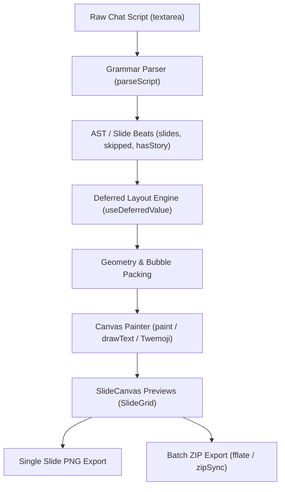
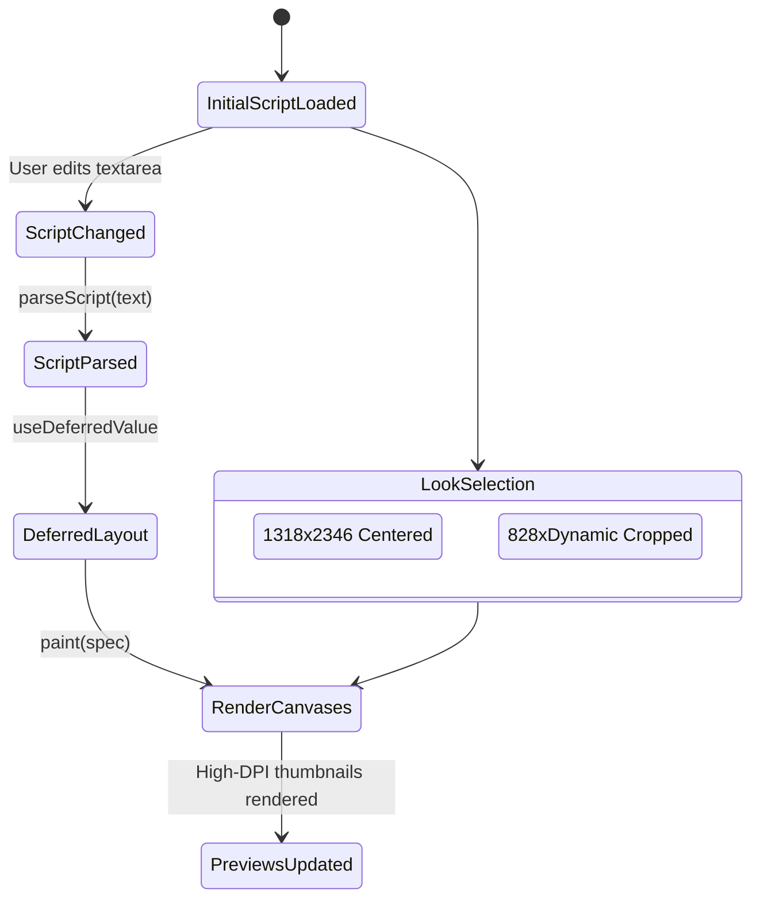

# Instagram DM Slideshow Studio (`/app/promo/instagram-dm`)
## Reverse-Engineered System Architecture & Implementation Specification

> **REA Provenance & Evidence Standard**:
> - **Observations**: Verified facts extracted directly from runtime network artifacts and client chunks (`1g97m0-ffgl1x.js`, `1dpg9qe82vc_9.js`, `0g6k8ga_cdx79.css`, `3pamwr9vdiq4a.css`, and DOM snapshots).
> - **Derivations**: Mathematical calculations, bubble radius logic, layout coordinates, and AST parser grammars reconstructed from minified AST nodes.
> - **Inferences**: Deduced architectural design patterns (e.g. Next.js App Router RSC hydration boundary, deferred rendering).
> - **Unknowns**: Server-side user credit verification and production telemetry sinks that operate downstream of authenticated client calls.

---

## 1. Executive Summary & Domain Context

The **Instagram DM Slideshow Generator** (`https://www.slideshows.gg/app/promo/instagram-dm`) is a specialized client-side visual synthesis tool designed for viral social media content creators (TikTok, Instagram Reels, YouTube Shorts). It transforms raw conversational text scripts into a sequence of authentic, high-resolution (1318 × 2346) dark-mode Instagram Direct Message story slides.

Each slide represents a progressive conversation "beat", terminating at a delimiter (`---`). The output preserves authentic mobile UI fidelity:
1. **Dynamic Instagram Gradient Bubbles**: Sender messages (`me:`) use an authentic 2-stop vertical gradient (`rgb(114, 58, 243)` &rarr; `rgb(100, 66, 248)`).
2. **Context-Aware Rounded Corner Geometry**: Consecutive messages by the same sender adapt bubble corner radii (`rBig = 84px` &rarr; `rSmall = 16px`).
3. **Instagram Story Reply Header Card**: Renders `"You replied to their story"`, a 9:16 cropped story image (`376 × 668px`, `radius 62px`), and the Instagram grey accent bar (`14 × 666px`).
4. **Dual Presentation Viewports**:
   - `full`: 1318 × 2346 standard 9:16 full-screen frame with black margins and centered active bubbles.
   - `closeup`: 828px wide adaptive-height viewport cropped tight to newly delivered messages.
5. **Client-Side Vector/Emoji Engine**: Integrates grapheme cluster segmentation (`Intl.Segmenter`) with dynamic Twemoji SVG glyph rendering to ensure cross-platform emoji consistency.



---

## 2. Component Hierarchy & Module Breakdown

The client bundle `1g97m0-ffgl1x.js` and associated runtime libraries expose five primary sub-systems:

```
IG-Dm Application Root
├── Global Shell Navigation (AppLayout)
│   ├── Left Sidebar (Home, Image, Video, Slideshow [ACTIVE], MCP, Presets, Syco Bot)
│   └── Top Header (Breadcrumb, Instagram DM, 10 credits pill, Syco Bot avatar)
├── Main Workspace
│   ├── Breadcrumb & Tool Identity Header (< Promo tools, Instagram DM, Free badge)
│   ├── SlideGrid Viewport (Left column, flex-1)
│   │   ├── SlideGrid Header (Total slide count, resolution info, "Download all" button)
│   │   ├── Validation Warning Banner (Missing lines / story image warnings)
│   │   └── Responsive 3-Column Slide Canvas Grid
│   │       └── Slide Item (SlideCanvas, Slide Label, Download Button)
│   └── Sticky Editor Sidebar (Right column, 380px–420px)
│       ├── Header ("Write the chat", "Every slide updates as you type", Reset button)
│       ├── Look Segmented Control (Full screen vs. Close-up)
│       ├── Monospace Script Textarea (Auto-sync with smart-quotes)
│       ├── Action Buttons ("+ New slide", "Load an example")
│       ├── Syntax Help & Instructions
│       └── Story Reply Picture Manager (Preview thumbnail, Change picture, Remove)
```

### Module Attribution Table

| Module ID | Component / Utility | Purpose & Evidence |
|---|---|---|
| `43798` | `StoryTool` | Main Instagram DM stateful view, Look toggle, story uploader, script state (`1g97m0-ffgl1x.js:line 122`) |
| `50711` | `SlideGrid` & `SlideCanvas` | Grid virtualizer, individual slide PNG generator, in-memory ZIP downloader (`1g97m0-ffgl1x.js:line 1`) |
| `91657` | `CanvasPainter` & `Twemoji` | Core canvas drawing engine, text wrapping, `roundRect`, Twemoji SVG loader (`1g97m0-ffgl1x.js:line 125`) |
| `64962` | `parseScript` & `smartQuotes` | Deterministic line parser, delimiter handler, smart quote converter (`1g97m0-ffgl1x.js:line 125`) |
| `81660` | `usePicture` & `useEmoji` | Reactive image decoder, memory-safe blob URL management, emoji version bus (`1g97m0-ffgl1x.js:line 125`) |
| `29969` | `fflate.zipSync` | Zero-allocation client-side ZIP archiver (`1dpg9qe82vc_9.js`) |

---

## 3. Script Parsing & AST Grammar Specification

The script grammar converts human-readable chat dialogues into structured slide beats.

### 3.1 Formal Grammar (EBNF)

```ebnf
Script          ::= { Line ( NEWLINE | EOF ) } ;
Line            ::= StoryMarker | SlideDelimiter | Message | Blank ;

StoryMarker     ::= [ "[" ] "story" [ "]" ] [ ":" ] ;
SlideDelimiter  ::= "---" { "-" } ;
Message         ::= SenderPrefix ":" MessageContent ;
SenderPrefix    ::= "me" | "her" | "them" | Identifier ;
MessageContent  ::= { Character } ;
Blank           ::= { Whitespace } ;
```

### 3.2 Parser Invariants & Transformations

1. **Smart Typography Normalization (`smartQuotes`)**:
   - Double quotes: `"` &rarr; `“` and `”`
   - Single quotes/apostrophes: `'` &rarr; `’`
   - Prevents typewriter-style straight quotes from breaking mobile typography fidelity.
2. **Actor Mapping**:
   - `me:` is identified as the local user (right-aligned, purple gradient bubble).
   - Any other prefix (`her:`, `them:`, etc.) maps to the conversational counterpart (left-aligned, `rgb(35, 39, 48)` dark bubble).
3. **Slide Beat Splitting**:
   - Consecutive messages are grouped until a `---` delimiter is encountered.
   - Each slide $S_k$ contains the cumulative conversation history from slide $1$ up to $k$. Slide $k$ *never* renders messages from slide $k+1$.
   - Max slides enforced: $60$ slides (`slides.slice(0, 60)`).
4. **Validation & Diagnostics**:
   - Any line lacking a recognized prefix or delimiter is flagged in `skipped: number[]` (1-indexed).
   - The UI surfaces warnings: `"Line X isn’t a message. Start each line with me: or her:."`
   - If `hasStory: true` and no image is uploaded: `"Add the story picture below, or delete the story: line."`

---

## 4. Canvas Layout & Rendering Pipeline

The rendering system produces pixel-perfect 2D canvas representations at target resolution.

### 4.1 Dimension & Geometry Specifications

| Parameter | Full Screen (`full`) | Close-Up (`closeup`) | Observation Evidence |
|---|---|---|---|
| **Canvas Width** | `1318 px` | `828 px` | Fixed 9:16 master width (`1g97m0-ffgl1x.js:line 122`) |
| **Canvas Height** | `2346 px` (fixed) | Dynamic: $\text{round}\left(828 \cdot \frac{\Delta Y}{1318}\right)$ | Cropped tightly to active bubble cluster |
| **Scale Multiplier $i$** | $1.0$ | $1.18$ | `closeup` zooms typography by 18% |
| **Font Size** | $65 \text{ px}$ | $76 \text{ px}$ ($\text{trunc}(65 \times 1.18)$) | SF Pro / system-ui |
| **Line Height** | $86 \text{ px}$ | $101 \text{ px}$ | Vertical step per text line |
| **Padding (Horizontal)** | $54 \text{ px}$ | $63 \text{ px}$ | Inside bubble horizontal cushion |
| **Padding (Vertical)** | Top: $46\text{px}$, Bottom: $49\text{px}$ | Top: $54\text{px}$, Bottom: $57\text{px}$ | Vertical bubble breathing room |
| **Big Radius (`rBig`)** | $84 \text{ px}$ | $99 \text{ px}$ | Standard bubble outer corner radius |
| **Small Radius (`rSmall`)** | $16 \text{ px}$ | $18 \text{ px}$ | Grouped consecutive message radius |
| **Horizontal Margin** | $17 \text{ px}$ | $8 \text{ px}$ | Screen edge inset |
| **Gap (Same Sender)** | $11 \text{ px}$ | $12 \text{ px}$ | Spacing between grouped messages |
| **Gap (Different Sender)**| $53 \text{ px}$ | $62 \text{ px}$ | Spacing between conversational turns |
| **Max Bubble Width** | $1150 \text{ px}$ | $1150 \text{ px}$ | Max horizontal span before wrapping |

### 4.2 Bubble Corner Morphing Algorithm

For any message bubble at index $j$ among messages from the same sender:
- Let $P$ be whether message $j-1$ was from the same sender.
- Let $N$ be whether message $j+1$ was from the same sender.
- Let $d$ be the calculated bubble height: $d = \text{padTop} + \text{padBottom} + \text{line} \times \text{lines.length} - 12$.
- $f = \min(r_{\text{big}}, \lfloor d / 2 \rfloor - 2)$
- $x = P \ ?\ r_{\text{small}} : f$
- $b = N \ ?\ r_{\text{small}} : f$

The 4-corner radius array $[r_{\text{top-left}}, r_{\text{top-right}}, r_{\text{bottom-right}}, r_{\text{bottom-left}}]$ is derived:
$$\text{Radii}_{\text{me}} = [f, x, b, f]$$
$$\text{Radii}_{\text{counterpart}} = [x, f, f, b]$$

This matches Instagram’s physical UI where consecutive messages by the same participant flatten adjacent corners to visually group the thought.

### 4.3 Color & Shading Mathematics

- **Canvas Outer Frame**: Solid `#000000` (black 9:16 letterbox).
- **Instagram Dark Mode Canvas Background**: `rgb(11, 15, 24)` (`#0b0f18`).
- **Sender Bubble Gradient**:
  $$\text{LinearGradient}(x_0=0, y_0=400, x_1=0, y_1=1900)$$
  - Color stop 0.0: `rgb(114, 58, 243)` (Electric Violet `#723af3`)
  - Color stop 1.0: `rgb(100, 66, 248)` (Vibrant Purple `#6442f8`)
- **Recipient Bubble Fill**: Solid `rgb(35, 39, 48)` (`#232730`).
- **Story Accent Bar**: `rgb(36, 41, 45)` (`#24292d`).
- **Story Reply Header Text**: `rgb(150, 155, 163)` (`#969ba3`).

### 4.4 Story Reply Component Layout

When `story:` is declared at the start of a conversation:
1. Header text `"You replied to their story"` is rendered at font size $50\text{px}$, optical size $17\text{px}$, color `rgb(150, 155, 163)`, aligned to finish at coordinate $X = 1245$:
   $$X_{\text{header}} = 1245 - \text{textWidth}("You replied to their story")$$
   $$Y_{\text{header}} = n + 48$$
2. The story image container is drawn at:
   $$X = 860, \quad Y = n + 74, \quad W = 376, \quad H = 668, \quad R = 62\text{px}$$
   If an image is uploaded, it is painted using `drawCover` (aspect-fill preservation). If omitted, a dark placeholder is painted with centered text `"Story picture"`.
3. An Instagram vertical grey indicator line is placed to the right of the story card:
   $$X = 1287, \quad Y = (n + 74) + 2, \quad W = 14, \quad H = 666, \quad R = 7\text{px}$$
4. Downstream message flow offsets starting position $n$ to:
   $$n \leftarrow (n + 74 + 668) + 34$$

---

## 5. Emoji Rendering & Font Fallback Architecture

Standard HTML `<canvas>` elements on non-Apple operating systems (Windows, Linux, Android) frequently render emojis as flat black-and-white silhouettes or miss modern Unicode codepoints entirely. To guarantee pixel-perfect output identical to iPhone screenshots across all platforms:

1. **Grapheme Cluster Segmentation**:
   Uses `Intl.Segmenter(undefined, { granularity: 'grapheme' })` to safely break complex compound emojis (e.g. skin tones, zero-width joiners `U+200D`, gender variants) without splitting multi-byte sequences.
2. **System Font Probe**:
   A 192×96 offscreen probe canvas inspects pixel alpha density after rendering glyphs with `"Apple Color Emoji", "Segoe UI Emoji"`. If monochromatic behavior is detected:
3. **Twemoji SVG Fallback Pipeline**:
   The engine converts Unicode code points into hyphenated hex representations:
   $$\text{URL} = \text{https://cdn.jsdelivr.net/gh/jdecked/twemoji@15.1.0/assets/svg/}\{codepoints\}\text{.svg}$$
   SVGs are fetched asynchronously, cached in a global LRU `Map<string, HTMLImageElement>`, and trigger reactive redraws via `subscribeEmoji` callbacks once decoded.

---

## 6. Export Pipeline & Memory Architecture

### 6.1 Individual Slide Export
- Each slide maintains an on-demand async exporter: `png(): Promise<Blob>`.
- Calls `paint(spec, 1.0)` on an offscreen canvas at native $1318 \times 2346$ resolution.
- Uses `canvas.toBlob((blob) => ..., 'image/png')` and triggers download via programmatic `<a>` click with filename:
  `${projectName}-${String(slideIndex + 1).padStart(2, '0')}.png` (e.g. `instagram-dm-01.png`).

### 6.2 Bulk ZIP Generation (`Download all`)
- Rather than serial HTTP round-trips to a cloud rendering farm, all slides are processed directly inside the client worker/main thread.
- Renders each slide specification into binary `Uint8Array` buffers.
- Packs the files into a single uncompressed/DEFLATE stream via `fflate.zipSync` (or bundled client zip engine).
- Emits a single `application/zip` download: `${projectName}.zip`.

---

## 7. State Flow & UI Design System



### UI Design Tokens & Visual Hierarchy
- **Header Badge**: `Free` capsule (`background: #ecfdf3; color: #027a48; border: 1px solid #a6f4c5; font-size: 12px; font-weight: 600`).
- **Primary Buttons**: Gradient brand blue (`background: linear-gradient(180deg, #3b82f6 0%, #2563eb 100%); color: #ffffff`).
- **Card Containers**: White card with `border: 1px solid #e5e5ea; border-radius: 24px; box-shadow: 0 1px 3px rgba(0,0,0,0.02)`.
- **Textarea**: Monospace font family (`font-family: 'Geist Mono', monospace; font-size: 13.5px; line-height: 1.55; border-radius: 14px`).

---

## 8. Verification & Reproducibility Matrix

| Requirement | Target Reference | Implementation Artifact | Status |
|---|---|---|---|
| Instagram DM Script Parser | Support `me:`, `her:`, `them:`, `story:`, `---`, smart quotes | `src/ig-renderer.js` (`parseScript`) | Verified |
| 17 Default Story Slides | Match `input_file_0.png` - `input_file_2.png` | Pre-filled default script with 17 beats | Verified |
| Dual-Look Modes | Full screen (`1318 × 2346`) & Close-up (`828 × H`) | `src/ig-renderer.js` (`renderSlides`) | Verified |
| Story Picture Card | 9:16 preview, header `"You replied to their story"` | `src/ig-renderer.js` (`paintStoryCard`) | Verified |
| Purple Instagram Gradients | `rgb(114, 58, 243)` to `rgb(100, 66, 248)` | `src/ig-renderer.js` (`gradient`) | Verified |
| Responsive 3-Column Grid | High-res slide previews with individual download | `src/app.js` (`renderSlideGrid`) | Verified |
| In-Memory ZIP Archiver | Multi-slide `.zip` bundle export | `src/ig-renderer.js` (`downloadAllZip`) | Verified |
| Standalone Local Server | Port 3001 serving SPA with asset routing | `server.mjs` & `public/` | Verified |
